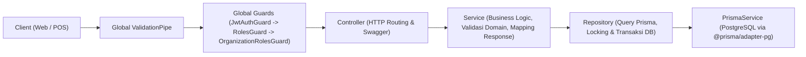

# Arsitektur Backend Admin Jualan

Dokumen ini menjelaskan arsitektur teknis, stack teknologi, pola desain, struktur direktori, serta konfigurasi runtime dari backend **Admin Jualan**.

---

## 1. Ringkasan Stack Teknologi

| Komponen                    | Teknologi / Library                                                    | Versi (di `package.json`)                    | Kegunaan                                                                 |
| --------------------------- | ---------------------------------------------------------------------- | -------------------------------------------- | ------------------------------------------------------------------------ |
| **Runtime & Bahasa**        | Node.js + TypeScript                                                   | TS `^6.0.3`, Target `ES2023`, `nodenext` ESM | Eksekusi aplikasi backend                                                |
| **Framework Web**           | NestJS (`@nestjs/core`, `@nestjs/platform-express`)                    | `^12.0.0`                                    | Kerangka kerja modular berbasis Express                                  |
| **Database & ORM**          | PostgreSQL + Prisma ORM (`@prisma/client`, `@prisma/adapter-pg`, `pg`) | Prisma `^7.9.1`, `pg ^8.22.0`                | Penyimpanan relasional & akses data type-safe dengan driver adapter `pg` |
| **Autentikasi**             | `@nestjs/jwt`, `argon2`                                                | JWT `^12.0.1`, Argon2 `^0.45.1`              | Penerbitan & verifikasi JWT serta hashing password/OTP                   |
| **Validasi & Transformasi** | `class-validator`, `class-transformer`                                 | `^0.15.1` / `^0.5.1`                         | Validasi DTO via global `ValidationPipe`                                 |
| **Dokumentasi API**         | `@nestjs/swagger`                                                      | `^12.0.0`                                    | Swagger UI otomatis di `/api`                                            |
| **Email Transaksional**     | `resend`                                                               | `^6.19.0`                                    | Pengiriman kode OTP verifikasi email                                     |
| **Static Assets**           | `@nestjs/serve-static`                                                 | `^12.0.0`                                    | Menyajikan file statis di `/uploads`                                     |
| **Testing**                 | Jest + Supertest                                                       | Jest `^30.0.0`                               | Unit test (`*.spec.ts`) & E2E test                                       |

---

## 2. Arsitektur Aplikasi & Pola Desain

Backend menggunakan arsitektur **Modular Monolith** khas NestJS dengan pemisahan layer yang konsisten di setiap modul bisnis:



### Tanggung Jawab Masing-Masing Layer

1. **Controller (`*.controller.ts`)**
   - Mendefinisikan route HTTP, decorator Swagger, dan metadata role (`@Public()`, `@Roles()`, `@OrganizationRoles()`).
   - Menerima `AuthenticatedRequest` (`request.user` berisi payload JWT) dan meneruskannya ke Service.
   - Tidak berisi query database atau business logic kompleks.

2. **Service (`*.service.ts`)**
   - Memvalidasi konteks organisasi (`organizationId` dari JWT payload), eksistensi entitas, aturan bisnis, serta memetakan error repository (seperti string union `'not-found'`, `'consumed'`, `'paid'`, atau Prisma error `P2002`) menjadi HTTP exception NestJS (`NotFoundException`, `ConflictException`, `BadRequestException`, `ForbiddenException`).
   - Melakukan transformasi data ke response DTO (misalnya mengonversi `Prisma.Decimal` ke `number` dan memfilter field sensitif).

3. **Repository (`*.repository.ts`)**
   - Berinteraksi langsung dengan `PrismaService`.
   - Mengelola transaksi database (`prisma.$transaction`), row-level locking (`SELECT ... FOR UPDATE`), serta isolasi transaksi `Serializable` pada operasi stok kritis (`OrderRepository`, `PreparationRepository`).

---

## 3. Struktur Direktori Proyek

```text
backend/
├── prisma/
│   ├── schema/              # Multi-file Prisma schema (model & enum terpisah)
│   ├── migrations/          # Riwayat migrasi SQL PostgreSQL
│   └── generated/           # Prisma Client hasil generate (moduleFormat: cjs)
├── src/
│   ├── main.ts              # Entry point, global prefix, CORS, ValidationPipe, Swagger
│   ├── app.module.ts        # Root module yang mengimpor seluruh feature module
│   ├── prisma/              # PrismaModule & PrismaService (global)
│   ├── common/              # Constants, enums, shared DTOs, pipes, dan types
│   ├── auth/                # Autentikasi JWT, guards, decorators, register/login/OTP
│   ├── email/               # Pengiriman OTP email menggunakan Resend
│   ├── user/                # Manajemen pengguna platform
│   ├── organization/        # Manajemen organisasi (tenant) & media sosial
│   ├── organization-user/   # Keanggotaan user dalam organisasi & approval
│   ├── inventory-item/      # Master bahan baku / item inventori
│   ├── inventory-lot/       # Batch/lot stok inventori & penyesuaian manual
│   ├── inventory-transaction/ # Riwayat mutasi stok inventori (read-only API)
│   ├── purchase/            # Pembelian bahan baku (Draft -> Finalized)
│   ├── preparation/         # Produksi/racikan batch bahan baku (Draft -> Completed)
│   ├── product/             # Master produk jual, resep bahan, & mode stok
│   ├── product-modifier/    # Grup modifier, opsi modifier, & assignment ke produk
│   ├── order/               # Transaksi penjualan (Dine-In, Takeaway, Delivery) & overview
│   └── cash-transaction/    # Pencatatan arus kas (Sale, Purchase, Investment, Profit Sharing)
└── docs/                    # Dokumentasi teknis backend
```

---

## 4. Konfigurasi Bootstrap (`src/main.ts`)

Beberapa perilaku global yang dikonfigurasi pada saat aplikasi dijalankan:

1. **Global Prefix & Static Files**:
   - Seluruh endpoint API memiliki prefix `/api`, kecuali `/uploads/(.*)`.
   - Folder lokal `uploads/` disajikan secara statis melalui prefix `/uploads`.
   - Swagger UI dapat diakses di `/api`.
2. **Body Parser**:
   - `bodyParser: false` pada `NestFactory.create`, lalu dipasang middleware `express.json` dengan limit `MAX_LOGO_BASE64_SIZE + 64 KiB` (`2 MiB + 64 KiB`, karena `MAX_LOGO_BASE64_SIZE = 2 * 1024 * 1024`) serta `urlencoded` dengan limit `100 KiB`.
3. **Global ValidationPipe**:
   - `transform: true`: otomatis mengonversi payload/query ke tipe DTO (mis. string ke `number` atau `Date` dengan `@Type()`).
   - `whitelist: true`: menghapus properti yang tidak didefinisikan di DTO.
   - `forbidNonWhitelisted: true`: mengembalikan `400 Bad Request` jika client mengirim properti asing yang tidak ada di DTO.
4. **CORS & Port**:
   - `app.enableCors()` aktif secara default untuk semua origin.
   - Server mendengarkan pada `process.env.PORT ?? 8080` di host `0.0.0.0`.

---

## 5. Multi-Tenancy & Isolasi Data

Aplikasi menerapkan **multi-tenancy berbasis `organizationId`**:

- Setiap entitas operasional (`InventoryItem`, `Purchase`, `Preparation`, `Product`, `ProductModifierGroup`, `Order`, `CashTransaction`, `Table`, `InventoryTransaction`) memiliki kolom `organizationId`.
- Konteks organisasi tidak dikirim melalui parameter URL/body pada modul operasional, melainkan **diambil langsung dari klaim `organizationId` di dalam JWT** (`request.user.organizationId`) setelah user memanggil `POST /api/auth/login/organization`.
- Jika token tidak memiliki `organizationId`, service akan menolak request dengan `403 Forbidden` (`Organization context is required` / `Organization userHeader is required`).

---

## 6. Variabel Lingkungan (Environment Variables)

Berdasarkan penelusuran kode sumber (`src/main.ts`, `src/prisma/prisma.service.ts`, `src/auth/auth.module.ts`, `src/email/email.service.ts`, `src/email/email.module.ts`), variabel lingkungan yang digunakan oleh aplikasi adalah:

| Variabel                            | Wajib                  | Kegunaan                                                           |
| ----------------------------------- | ---------------------- | ------------------------------------------------------------------ |
| `DATABASE_URL`                      | Ya                     | Connection string PostgreSQL untuk `PrismaPg` & `prisma.config.ts` |
| `JWT_SECRET`                        | Ya                     | Secret key untuk menandatangani dan memverifikasi JWT              |
| `RESEND_API_KEY`                    | Ya (saat kirim email)  | API key untuk layanan email Resend                                 |
| `RESEND_FROM_EMAIL` / `RESEND_FROM` | Ya (saat kirim email)  | Alamat pengirim email OTP verifikasi                               |
| `PORT`                              | Tidak (default `8080`) | Port HTTP server NestJS                                            |
