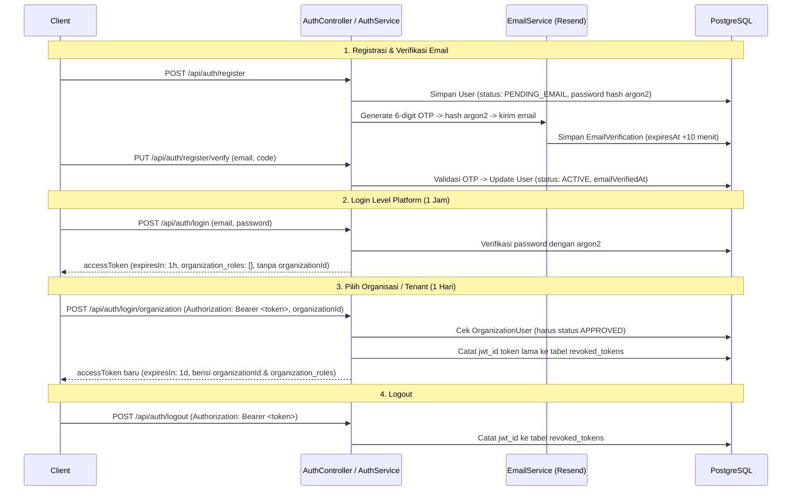

# Authentication & Authorization

Dokumen ini menjelaskan mekanisme autentikasi berbasis JWT, verifikasi email OTP, pencabutan token (token revocation), serta sistem otorisasi berbasis role platform dan role organisasi.

---

## 1. Alur Autentikasi

Backend menggunakan **JSON Web Token (JWT)** yang diterbitkan oleh `@nestjs/jwt` dan divalidasi secara global oleh `JwtAuthGuard`.



---

## 2. Struktur Payload JWT

### A. Token Login Platform (`POST /api/auth/login`)

- Masa berlaku: **1 jam** (`{ expiresIn: '1h' }`).
- Isi payload:

  ```json
  {
    "sub": "user-uuid",
    "name": "user@example.com",
    "roles": ["USER"],
    "organization_roles": [],
    "jwt_id": "random-uuid"
  }
  ```

### B. Token Konteks Organisasi (`POST /api/auth/login/organization`)

- Masa berlaku: **1 hari** (mengikuti konfigurasi `JwtModule.register` di `AuthModule`: `signOptions: { expiresIn: '1d' }`).
- Token platform sebelumnya langsung di-revoke secara otomatis saat token organisasi diterbitkan.
- Isi payload:

  ```json
  {
    "sub": "user-uuid",
    "name": "user@example.com",
    "roles": ["USER"],
    "organizationId": "organization-uuid",
    "organization_roles": ["OWNER"],
    "jwt_id": "random-uuid"
  }
  ```

---

## 3. Global Guards & Mekanisme Validasi

Di `src/auth/auth.module.ts`, terdapat **3 guard global (`APP_GUARD`)** yang dijalankan secara berurutan pada setiap request:

1. **`JwtAuthGuard`** (`src/auth/guards/jwt-auth.guard.ts`)
   - Mengecek decorator `@Public()`. Jika ada, request langsung diizinkan tanpa token.
   - Mengambil Bearer token dari header `Authorization: Bearer <token>`.
   - Memverifikasi signature dan masa berlaku JWT via `jwtService.verifyAsync(token)`.
   - Memastikan klaim `jwt_id` ada dan tidak kosong.
   - Memeriksa tabel `revoked_tokens` berdasarkan `jwtId`. Jika ditemukan, request ditolak dengan `401 Unauthorized` (`Access token is no longer valid`).
   - Menyimpan payload ke `request.user`.

2. **`RolesGuard`** (`src/auth/guards/role.guard.ts`) dan **`OrganizationRolesGuard`** (`src/auth/guards/organization-role.guard.ts`)
   - Keduanya membaca metadata dari decorator `@Roles(...)` (`ROLES_KEY`) dan `@OrganizationRoles(...)` (`ORGANIZATION_ROLES_KEY`).
   - Jika endpoint tidak memiliki kedua decorator tersebut, akses diizinkan (`true`).
   - Jika salah satu atau keduanya ada, guard menggunakan logika **OR**:

     ```ts
     requiredRoles?.some((role) => user.roles?.includes(role)) ||
       requiredOrganizationRoles?.some((role) =>
         user.organization_roles?.includes(role),
       ) ||
       false;
     ```

> [!NOTE]
> **Catatan Teknis (Perlu Dikonfirmasi):**
>
> 1. `RolesGuard` dan `OrganizationRolesGuard` memiliki implementasi yang identik dan keduanya didaftarkan sebagai `APP_GUARD`.
> 2. Karena evaluasi menggunakan operator `OR`, jika sebuah endpoint memiliki `@Roles(...)` sekaligus `@OrganizationRoles(...)`, terpenuhinya salah satu sudah cukup untuk lolos guard.
> 3. Pada `AuthService.login()`, sistem **tidak memeriksa** `user.status` (misalnya `PENDING_EMAIL` atau `SUSPENDED`) sebelum menerbitkan token login platform. Selain itu, `AuthService.login()` mengembalikan objek `user` mentah dari repository tanpa menghapus properti `password` (berbeda dengan `register()` dan `verifyRegistration()` yang memanggil `toResponse()`).

---

## 4. Matriks Role & Hak Akses

### A. Platform Roles (`UserRole`)

Digunakan untuk pengelolaan level sistem/platform:

- `SUPER_ADMIN`: Akses penuh ke manajemen `users` dan `organizations` (termasuk delete organization, suspend user, update user).
- `ADMIN`: Dapat melihat daftar/detail `users`, mengaktifkan user (`POST /users/:id/activate`), serta membuat/melihat/mengubah `organizations`.
- `USER`: User standar. Dapat mengakses opsi user (`GET /users/options`), daftar organisasi miliknya (`GET /users/:id/organizations`), serta memilih organisasi untuk masuk ke konteks tenant.

### B. Organization Roles (`OrganizationUserRole`)

Digunakan untuk seluruh modul operasional di dalam suatu organisasi:

- `OWNER`: Pemilik organisasi. Memiliki akses penuh ke semua fitur operasional, termasuk `approve` member baru (`POST /organization-users/:id/approve`), menghapus `Purchase` berstatus `FINALIZED`, dan menghapus `Preparation` berstatus `COMPLETED`.
- `ADMIN`: Administrator organisasi. Dapat mengelola produk, modifier, order, pembelian (`DRAFT`), persiapan (`DRAFT`), kas, lot inventori, serta menambah/suspend/activate `organization-users`. Tidak dapat menghapus `Purchase` yang sudah `FINALIZED` atau `Preparation` yang sudah `COMPLETED`, dan tidak dapat melakukan `approve` keanggotaan.
- `MEMBER`: Staf/anggota organisasi. Hanya dapat melihat daftar/detail/aset `inventory-items`, melihat `inventory-lots`, melihat `inventory-transactions`, melihat opsi produk (`GET /products/options`), melihat `product-modifier-groups` & assignmentnya, melihat `purchases`, serta melihat `cash-transactions` (termasuk `balance` dan `cash-flow`). Tidak dapat membuat/mengubah transaksi `orders`, `purchases`, `preparations`, `products`, atau `cash-transactions`.

---

## 5. Keamanan Password & OTP

- **Password**: Di-hash menggunakan algoritma `argon2` saat registrasi (`AuthService.register`) dan pembuatan user (`UserService.create`).
- **OTP Verifikasi Email**:
  - Terdiri dari 6 digit acak (`randomInt(100000, 1000000)`).
  - Disimpan dalam bentuk hash `argon2` (`otpHash`) pada tabel `email_verifications`.
  - Masa berlaku OTP: **10 menit** (`OTP_EXPIRATION_TIME`).
  - Jeda pengiriman ulang (resend delay): **60 detik** (`RESEND_DELAY`).
  - Batas percobaan salah: maksimal **5 kali** gagal tidak terblokir; pada pengecekan saat `attempts > 5` (yaitu setelah 6 kali percobaan salah), verifikasi ditolak dengan `400 Bad Request` dan user harus meminta OTP baru via `POST /api/auth/resend-otp`.
