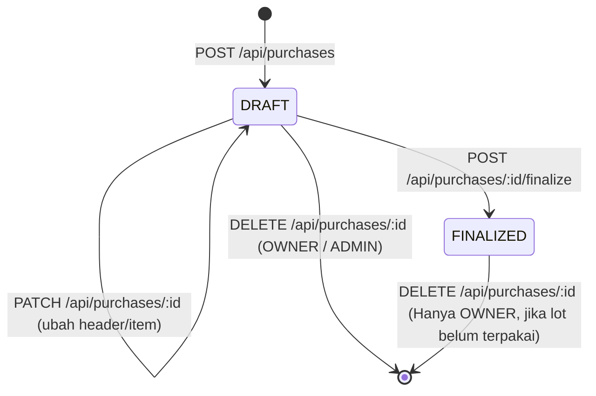

# Purchase Management

## Alur Pembelian Bahan Baku

1. **Pembuatan Draf (`DRAFT`)**:
   - `OWNER` atau `ADMIN` membuat draf pembelian beserta minimal 1 `PurchaseItem` (`quantity` kemasan, `packageSize` isi per kemasan, `totalCost`, `receivedAt`, `expiredAt?`).
   - Kombinasi `(organizationId, supplierName, invoiceNumber)` harus unik.
   - Pada tahap `DRAFT`, stok inventori dan kas **belum berubah**.
2. **Pembaruan Draf**:
   - Selama berstatus `DRAFT`, item dapat ditambah, diubah, atau dihapus (`deletedPurchaseItemIds`).
3. **Finalisasi (`FINALIZED`)**:
   - Mengubah status menjadi `FINALIZED`.
   - Membuat 1 `InventoryLot` per `PurchaseItem` dengan `quantity = remainingQuantity = quantity * packageSize` dan `unitCost = totalCost / totalQuantity`.
   - Mencatat `InventoryTransaction` tipe `PURCHASE` dengan `referenceId = purchase.id`.
   - Mencatat `CashTransaction` tipe `PURCHASE` sebesar total seluruh `item.totalCost`.
4. **Penghapusan**:
   - Pembelian `FINALIZED` hanya dapat dihapus oleh `OWNER` dan hanya jika seluruh `InventoryLot` yang dihasilkan belum berkurang (`remainingQuantity == quantity`) serta belum pernah dipakai oleh `PREPARATION_OUT`.
   - Penghapusan akan menghapus `InventoryTransaction` (`PURCHASE`), `InventoryLot`, `PurchaseItem`, dan `Purchase`. *(Catatan: `CashTransaction` tidak ikut dihapus secara otomatis.)*
