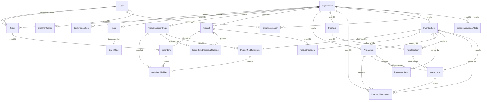

# Dokumentasi Database & Prisma Schema

Backend menggunakan **PostgreSQL** dengan **Prisma ORM v7** (`prisma-client` dengan `@prisma/adapter-pg`). Konfigurasi multi-file schema berada di folder `prisma/schema/` (dikonfigurasi melalui `prisma.config.ts`).

---

## 1. Diagram Relasi Entitas (ERD)

---

## 2. Daftar Model Prisma

### 2.1 `User` (`users`)

**Deskripsi:** Menyimpan data akun pengguna di level platform beserta status verifikasi email dan hak akses globalnya. Digunakan pada modul `auth`, `user`, `organization-user`, dan `order` (sebagai kasir atau pelanggan).

| Field | Type | Required | Default | Description |
| --- | --- | --- | --- | --- |
| `id` | `String` (`@db.Uuid`) | Yes | `uuid()` | Identifier unik pengguna |
| `email` | `String` (`@db.VarChar(255)`) | Yes | - | Alamat email unik pengguna untuk login dan verifikasi |
| `password` | `String` (`@db.VarChar(255)`) | Yes | - | Hash password pengguna (Argon2) |
| `name` | `String` (`@db.VarChar(255)`) | Yes | - | Nama lengkap pengguna |
| `emailVerifiedAt` | `DateTime?` | No | `null` | Waktu verifikasi email berhasil; `null` jika belum verifikasi OTP |
| `status` | `UserStatus` | Yes | `PENDING_EMAIL` | Status akun (`PENDING_EMAIL`, `ACTIVE`, `SUSPENDED`) |
| `role` | `UserRole` | Yes | `USER` | Role global platform (`USER`, `ADMIN`, `SUPER_ADMIN`) |
| `createdAt` | `DateTime` | Yes | `now()` | Waktu record dibuat |
| `updatedAt` | `DateTime` | Yes | `@updatedAt` | Waktu terakhir record diperbarui |

**Index & Constraint:** `@unique` pada `email`, `@@index([createdAt])`.

---

### 2.2 `EmailVerification` (`email_verifications`)

**Deskripsi:** Menyimpan data OTP verifikasi email sementara untuk proses registrasi pengguna.

| Field | Type | Required | Default | Description |
| --- | --- | --- | --- | --- |
| `id` | `String` (`@db.Uuid`) | Yes | `uuid()` | Identifier unik record verifikasi |
| `userId` | `String` (`@db.Uuid`) | Yes | - | Foreign key ke `User.id` |
| `otpHash` | `String` | Yes | - | Hash kode OTP 6 digit menggunakan Argon2 |
| `attempts` | `Int` (`@db.SmallInt`) | Yes | `1` | Jumlah percobaan verifikasi OTP yang gagal (di-reset ke `0` saat create/resend oleh `EmailService`) |
| `lastSentAt` | `DateTime` | Yes | - | Waktu terakhir OTP dikirimkan (untuk validasi jeda resend 60 detik) |
| `expiresAt` | `DateTime` | Yes | - | Waktu kadaluarsa OTP (10 menit sejak dikirim) |
| `createdAt` | `DateTime` | Yes | `now()` | Waktu record dibuat |
| `updatedAt` | `DateTime` | Yes | `@updatedAt` | Waktu terakhir record diperbarui |

**Index & Constraint:** `@@unique([userId])` (1 user hanya memiliki 1 record verifikasi aktif), relasi ke `User`.

---

### 2.3 `RevokedToken` (`revoked_tokens`)

**Deskripsi:** Daftar blacklist token JWT yang telah dicabut (saat logout atau saat berpindah organisasi via `login/organization`).

| Field | Type | Required | Default | Description |
| --- | --- | --- | --- | --- |
| `id` | `String` (`@db.Uuid`) | Yes | `uuid()` | Identifier unik record |
| `jwtId` | `String` | Yes | - | Nilai klaim `jwt_id` dari JWT yang dicabut |
| `createdAt` | `DateTime` | Yes | `now()` | Waktu token dicabut |

**Index & Constraint:** `@unique` pada `jwtId`.

---

### 2.4 `Organization` (`organizations`)

**Deskripsi:** Entitas tenant/bisnis (toko/outlet) yang menaungi seluruh data operasional (produk, inventori, pembelian, order, dan kas).

| Field | Type | Required | Default | Description |
| --- | --- | --- | --- | --- |
| `id` | `String` (`@db.Uuid`) | Yes | `uuid()` | Identifier unik organisasi |
| `name` | `String` (`@db.VarChar(255)`) | Yes | - | Nama organisasi/usaha |
| `username` | `String?` (`@db.VarChar(30)`) | No | `null` | Username unik opsional organisasi |
| `address` | `String` (`@db.VarChar(255)`) | Yes | - | Alamat fisik organisasi |
| `email` | `String` (`@db.VarChar(255)`) | Yes | - | Email kontak organisasi |
| `phone` | `String` (`@db.VarChar(16)`) | Yes | - | Nomor telepon organisasi |
| `logoBase64` | `String?` | No | `null` | Logo organisasi dalam format string Base64 (wajib dikirim saat create via API, maks 2 MiB) |
| `createdAt` | `DateTime` | Yes | `now()` | Waktu record dibuat |
| `updatedAt` | `DateTime` | Yes | `@updatedAt` | Waktu terakhir record diperbarui |

**Index & Constraint:** `@unique` pada `username`, `@@index([createdAt])`.

---

### 2.5 `OrganizationUser` (`organization_users`)

**Deskripsi:** Tabel relasi many-to-many antara `User` dan `Organization` yang menyimpan role dan status persetujuan keanggotaan user dalam organisasi.

| Field | Type | Required | Default | Description |
| --- | --- | --- | --- | --- |
| `id` | `String` (`@db.Uuid`) | Yes | `uuid()` | Identifier unik keanggotaan |
| `userId` | `String` (`@db.Uuid`) | Yes | - | Foreign key ke `User.id` (anggota) |
| `organizationId` | `String` (`@db.Uuid`) | Yes | - | Foreign key ke `Organization.id` |
| `role` | `OrganizationUserRole` | Yes | - | Role di dalam organisasi (`OWNER`, `ADMIN`, `MEMBER`) |
| `status` | `OrganizationUserStatus` | Yes | `PENDING_APPROVAL` | Status keanggotaan (`PENDING_APPROVAL`, `APPROVED`, `REJECTED`, `SUSPENDED`) |
| `approvedAt` | `DateTime?` | No | `null` | Waktu persetujuan oleh Owner; `null` jika belum di-approve |
| `approvedById` | `String?` (`@db.Uuid`) | No | `null` | Foreign key ke `User.id` (Owner yang menyetujui) |
| `createdAt` | `DateTime` | Yes | `now()` | Waktu record dibuat |
| `updatedAt` | `DateTime` | Yes | `@updatedAt` | Waktu terakhir record diperbarui |
| `updatedById` | `String?` (`@db.Uuid`) | No | `null` | Foreign key ke `User.id` (user yang terakhir mengubah) |

**Index & Constraint:** `@@unique([organizationId, userId])` mencegah satu user terdaftar ganda di organisasi yang sama.

---

### 2.6 `OrganizationSocialMedia` (`organization_social_medias`)

**Deskripsi:** Menyimpan daftar akun media sosial milik organisasi.

| Field | Type | Required | Default | Description |
| --- | --- | --- | --- | --- |
| `id` | `String` (`@db.Uuid`) | Yes | `uuid()` | Identifier unik record |
| `organizationId` | `String` (`@db.Uuid`) | Yes | - | Foreign key ke `Organization.id` (`onDelete: Cascade`) |
| `platform` | `SocialMediaPlatform` | Yes | - | Platform media sosial |
| `username` | `String` (`@db.VarChar(30)`) | Yes | - | Handle/username akun pada platform tersebut |
| `sortOrder` | `Int` | Yes | `0` | Urutan tampilan |
| `createdAt` | `DateTime` | Yes | `now()` | Waktu record dibuat |
| `updatedAt` | `DateTime` | Yes | `@updatedAt` | Waktu terakhir record diperbarui |

**Index & Constraint:** `@@unique([organizationId, platform, username])`.

---

### 2.7 `InventoryItem` (`inventory_items`)

**Deskripsi:** Master item bahan baku atau barang inventori dalam organisasi. Total stok dan nilainya dihitung secara dinamis dari agregasi `InventoryLot` terkait.

| Field | Type | Required | Default | Description |
| --- | --- | --- | --- | --- |
| `id` | `String` (`@db.Uuid`) | Yes | `uuid()` | Identifier unik item inventori |
| `organizationId` | `String` (`@db.Uuid`) | Yes | - | Foreign key ke `Organization.id` |
| `name` | `String` (`@db.VarChar(255)`) | Yes | - | Nama item inventori |
| `isActive` | `Boolean` | Yes | `true` | Status aktif (soft delete fallback menjadi `false` jika sudah direferensikan di tabel lain) |
| `unit` | `InventoryUnit` | Yes | `GRAM` | Satuan dasar pengukuran stok (`GRAM`, `ML`, `PCS`) |
| `createdAt` | `DateTime` | Yes | `now()` | Waktu record dibuat |
| `updatedAt` | `DateTime` | Yes | `@updatedAt` | Waktu terakhir record diperbarui |

**Index & Constraint:** `@@index([organizationId, isActive])`.

---

### 2.8 `InventoryLot` (`inventory_lots`)

**Deskripsi:** Merepresentasikan batch/lot stok fisik suatu `InventoryItem` untuk pelacakan biaya dan alokasi **FIFO** (`receivedAt ASC, id ASC`). Lot berasal dari pembelian (`purchaseItemId`), hasil produksi internal (`preparationOutputId`), atau shortage lot otomatis saat stok negatif diizinkan.

| Field | Type | Required | Default | Description |
| --- | --- | --- | --- | --- |
| `id` | `String` (`@db.Uuid`) | Yes | `uuid()` | Identifier unik lot |
| `inventoryItemId` | `String` (`@db.Uuid`) | Yes | - | Foreign key ke `InventoryItem.id` |
| `purchaseItemId` | `String?` (`@db.Uuid`) | No | `null` | Foreign key unik ke `PurchaseItem.id` (`onDelete: Cascade`); `null` jika bukan dari pembelian |
| `preparationOutputId` | `String?` (`@db.Uuid`) | No | `null` | Foreign key unik ke `Preparation.id`; `null` jika bukan hasil preparation |
| `quantity` | `Decimal` (`@db.Decimal(15, 2)`) | Yes | - | Kuantitas awal lot dalam unit dasar (bernilai `0` jika merupakan shortage lot) |
| `remainingQuantity` | `Decimal` (`@db.Decimal(15, 2)`) | Yes | - | Sisa stok lot saat ini; dapat bernilai negatif jika kebijakan `ALLOW_NEGATIVE` memicu shortage |
| `unitCost` | `Decimal` (`@db.Decimal(15, 3)`) | Yes | - | Harga pokok per satuan dasar (`totalCost / quantity`, `0` jika shortage lot) |
| `totalCost` | `Decimal` (`@db.Decimal(15, 2)`) | Yes | - | Total biaya awal lot |
| `receivedAt` | `DateTime` | Yes | - | Tanggal masuk lot (kunci pengurutan FIFO) |
| `expiredAt` | `DateTime?` | No | `null` | Tanggal kadaluarsa lot (opsional) |
| `createdAt` | `DateTime` | Yes | `now()` | Waktu record dibuat |
| `updatedAt` | `DateTime` | Yes | `@updatedAt` | Waktu terakhir record diperbarui |

**Index & Constraint:** `@unique` pada `purchaseItemId` dan `preparationOutputId`; `@@index([inventoryItemId, receivedAt])`, `@@index([purchaseItemId])`.

---

### 2.9 `InventoryTransaction` (`inventory_transactions`)

**Deskripsi:** Ledger/audit log seluruh pergerakan stok masuk dan keluar pada `InventoryLot`.

| Field | Type | Required | Default | Description |
| --- | --- | --- | --- | --- |
| `id` | `String` (`@db.Uuid`) | Yes | `uuid()` | Identifier unik transaksi inventori |
| `organizationId` | `String` (`@db.Uuid`) | Yes | - | Foreign key ke `Organization.id` |
| `inventoryItemId` | `String` (`@db.Uuid`) | Yes | - | Foreign key ke `InventoryItem.id` |
| `inventoryLotId` | `String` (`@db.Uuid`) | Yes | - | Foreign key ke `InventoryLot.id` |
| `type` | `InventoryTransactionType` | Yes | - | Jenis mutasi (`PURCHASE`, `SALE`, `PREPARATION_IN`, `PREPARATION_OUT`, `ADJUSTMENT_IN`, `ADJUSTMENT_OUT`, `WASTE`, `RETURN`) |
| `referenceId` | `String?` (`@db.Uuid`) | No | `null` | UUID referensi dokumen sumber (`purchase.id`, `order.id`, atau `preparation.id`); `null` untuk adjustment manual lot |
| `quantity` | `Decimal` (`@db.Decimal(15, 3)`) | Yes | - | Kuantitas yang bermutasi |
| `unitCost` | `Decimal` (`@db.Decimal(15, 3)`) | Yes | `0` | Harga pokok per unit pada transaksi ini |
| `totalCost` | `Decimal` (`@db.Decimal(15, 2)`) | Yes | `0` | Total nilai biaya transaksi (`unitCost * quantity`) |
| `createdAt` | `DateTime` | Yes | `now()` | Waktu transaksi dicatat |

**Index & Constraint:** `@@index([organizationId, createdAt])`.

---

### 2.10 `Purchase` (`purchases`)

**Deskripsi:** Header transaksi pembelian bahan baku dari supplier.

| Field | Type | Required | Default | Description |
| --- | --- | --- | --- | --- |
| `id` | `String` (`@db.Uuid`) | Yes | `uuid()` | Identifier unik pembelian |
| `organizationId` | `String` (`@db.Uuid`) | Yes | - | Foreign key ke `Organization.id` |
| `status` | `PurchaseStatus` | Yes | `DRAFT` | Status dokumen (`DRAFT` atau `FINALIZED`) |
| `supplierName` | `String?` | No | `null` | Nama supplier |
| `invoiceNumber` | `String?` | No | `null` | Nomor faktur/invoice pembelian |
| `purchasedAt` | `DateTime` | Yes | - | Tanggal transaksi pembelian |
| `createdAt` | `DateTime` | Yes | `now()` | Waktu record dibuat |
| `updatedAt` | `DateTime` | Yes | `@updatedAt` | Waktu terakhir record diperbarui |

**Index & Constraint:** `@@unique([organizationId, supplierName, invoiceNumber])` mencegah duplikasi invoice dari supplier yang sama dalam satu organisasi.

---

### 2.11 `PurchaseItem` (`purchase_items`)

**Deskripsi:** Detail item barang dalam satu transaksi pembelian (`Purchase`). Saat pembelian difinalisasi, setiap `PurchaseItem` menghasilkan 1 `InventoryLot` dengan total kuantitas `quantity * packageSize`.

| Field | Type | Required | Default | Description |
| --- | --- | --- | --- | --- |
| `id` | `String` (`@db.Uuid`) | Yes | `uuid()` | Identifier unik item pembelian |
| `purchaseId` | `String` (`@db.Uuid`) | Yes | - | Foreign key ke `Purchase.id` (`onDelete: Cascade`) |
| `inventoryItemId` | `String` (`@db.Uuid`) | Yes | - | Foreign key ke `InventoryItem.id` |
| `quantity` | `Int` | Yes | `0` | Jumlah kemasan/paket yang dibeli |
| `packageSize` | `Decimal` (`@db.Decimal(15, 2)`) | Yes | - | Isi per kemasan dalam unit dasar `InventoryItem` |
| `totalCost` | `Decimal` (`@db.Decimal(15, 2)`) | Yes | - | Total harga beli untuk item ini |
| `receivedAt` | `DateTime` | Yes | - | Tanggal penerimaan barang (menjadi `receivedAt` lot) |
| `expiredAt` | `DateTime?` | No | `null` | Tanggal kadaluarsa barang (opsional) |
| `createdAt` | `DateTime` | Yes | `now()` | Waktu record dibuat |
| `updatedAt` | `DateTime` | Yes | `@updatedAt` | Waktu terakhir record diperbarui |

**Index & Constraint:** `@@index([purchaseId])`.

---

### 2.12 `Preparation` (`preparations`)

**Deskripsi:** Dokumen produksi/racikan internal yang mengolah beberapa bahan baku (`PreparationItem`) menjadi 1 item inventori output (`outputInventoryItemId`).

| Field | Type | Required | Default | Description |
| --- | --- | --- | --- | --- |
| `id` | `String` (`@db.Uuid`) | Yes | `uuid()` | Identifier unik preparation |
| `organizationId` | `String` (`@db.Uuid`) | Yes | - | Foreign key ke `Organization.id` |
| `name` | `String` (`@db.VarChar(255)`) | Yes | - | Nama batch preparation |
| `status` | `PreparationStatus` | Yes | `DRAFT` | Status (`DRAFT`: bahan sudah direservasi; `COMPLETED`: output lot sudah dibuat) |
| `preparedAt` | `DateTime` | Yes | `now()` | Waktu persiapan/produksi |
| `expiredAt` | `DateTime?` | No | `null` | Tanggal kadaluarsa hasil preparation |
| `notes` | `String?` (`@db.Text`) | No | `null` | Catatan tambahan/resep |
| `outputInventoryItemId` | `String` (`@db.Uuid`) | Yes | - | Foreign key ke `InventoryItem.id` untuk item hasil |
| `outputQuantity` | `Decimal` (`@db.Decimal(15, 2)`) | Yes | - | Kuantitas hasil produksi |
| `outputUnitCost` | `Decimal` (`@db.Decimal(15, 3)`) | Yes | - | HPP per unit output (`outputTotalCost / outputQuantity`, dibulatkan ke bawah 3 desimal) |
| `outputTotalCost` | `Decimal` (`@db.Decimal(15, 2)`) | Yes | - | Total HPP seluruh bahan baku yang digunakan |
| `createdAt` | `DateTime` | Yes | `now()` | Waktu record dibuat |
| `updatedAt` | `DateTime` | Yes | `@updatedAt` | Waktu terakhir record diperbarui |

**Index & Constraint:** `@@index([organizationId, preparedAt])`.

---

### 2.13 `PreparationItem` (`preparation_items`)

**Deskripsi:** Rincian bahan baku yang dikonsumsi oleh satu `Preparation`.

| Field | Type | Required | Default | Description |
| --- | --- | --- | --- | --- |
| `id` | `String` (`@db.Uuid`) | Yes | `uuid()` | Identifier unik item bahan |
| `preparationId` | `String` (`@db.Uuid`) | Yes | - | Foreign key ke `Preparation.id` (`onDelete: Cascade`) |
| `inventoryItemId` | `String` (`@db.Uuid`) | Yes | - | Foreign key ke `InventoryItem.id` |
| `quantity` | `Decimal` (`@db.Decimal(15, 2)`) | Yes | - | Kuantitas bahan yang digunakan |
| `unitCost` | `Decimal` (`@db.Decimal(15, 3)`) | Yes | - | Biaya rata-rata tertimbang per unit bahan dari alokasi FIFO |
| `totalCost` | `Decimal` (`@db.Decimal(15, 2)`) | Yes | - | Total biaya bahan (`unitCost * quantity`) |

**Index & Constraint:** `@@index([preparationId])`.

---

### 2.14 `Product` (`products`)

**Deskripsi:** Master produk/menu yang dijual di aplikasi POS/Order.

| Field | Type | Required | Default | Description |
| --- | --- | --- | --- | --- |
| `id` | `String` (`@db.Uuid`) | Yes | `uuid()` | Identifier unik produk |
| `organizationId` | `String` (`@db.Uuid`) | Yes | - | Foreign key ke `Organization.id` |
| `name` | `String` | Yes | - | Nama produk (unik per organisasi) |
| `sellingPrice` | `Decimal` (`@db.Decimal(15, 2)`) | Yes | - | Harga jual dasar produk |
| `isActive` | `Boolean` | Yes | `true` | Status aktif; produk nonaktif tidak dapat ditambahkan ke order baru |
| `stockManagement` | `ProductStockManagement` | Yes | `UNTRACKED` | Mode manajemen stok (`UNTRACKED`, `MANUAL`, `INVENTORY`) |
| `stock` | `Int?` | No | `null` | Counter stok manual (hanya terisi jika `stockManagement = MANUAL`; `null` untuk mode lain) |
| `inventoryPolicy` | `InventoryPolicy` | Yes | `STRICT` | Kebijakan stok inventori (`STRICT` atau `ALLOW_NEGATIVE`) saat `stockManagement = INVENTORY` |
| `createdAt` | `DateTime` | Yes | `now()` | Waktu record dibuat |
| `updatedAt` | `DateTime` | Yes | `@updatedAt` | Waktu terakhir record diperbarui |

**Index & Constraint:** `@@unique([organizationId, name])`, `@@index([organizationId, isActive])`.

---

### 2.15 `ProductIngredient` (`product_ingredients`)

**Deskripsi:** Komposisi resep bahan baku untuk satu `Product` (digunakan untuk menghitung stok mode `INVENTORY` dan estimasi HPP/costing).

| Field | Type | Required | Default | Description |
| --- | --- | --- | --- | --- |
| `id` | `String` (`@db.Uuid`) | Yes | `uuid()` | Identifier unik bahan produk |
| `productId` | `String` (`@db.Uuid`) | Yes | - | Foreign key ke `Product.id` |
| `inventoryItemId` | `String` (`@db.Uuid`) | Yes | - | Foreign key ke `InventoryItem.id` |
| `quantity` | `Decimal` (`@db.Decimal(15, 2)`) | Yes | - | Takaran bahan yang dibutuhkan untuk 1 porsi produk |
| `createdAt` | `DateTime` | Yes | `now()` | Waktu record dibuat |
| `updatedAt` | `DateTime` | Yes | `@updatedAt` | Waktu terakhir record diperbarui |

**Index & Constraint:** `@@unique([productId, inventoryItemId])`.

---

### 2.16 `ProductModifierGroup` (`product_modifier_groups`)

**Deskripsi:** Grup pilihan tambahan/kustomisasi produk yang reusable (misalnya "Level Pedas", "Topping") dalam satu organisasi.

| Field | Type | Required | Default | Description |
| --- | --- | --- | --- | --- |
| `id` | `String` (`@db.Uuid`) | Yes | `uuid()` | Identifier unik grup modifier |
| `organizationId` | `String` (`@db.Uuid`) | Yes | - | Foreign key ke `Organization.id` |
| `name` | `String` (`@db.VarChar(255)`) | Yes | - | Nama grup modifier (unik per organisasi) |
| `description` | `String?` (`@db.Text`) | No | `null` | Deskripsi grup |
| `isRequired` | `Boolean` | Yes | `false` | Apakah pelanggan wajib memilih minimal 1 opsi |
| `minSelection` | `Int` | Yes | `0` | Jumlah pilihan minimum |
| `maxSelection` | `Int` | Yes | `1` | Jumlah pilihan maksimum |
| `isMultiple` | `Boolean` | Yes | `false` | Apakah boleh memilih lebih dari 1 opsi |
| `isActive` | `Boolean` | Yes | `true` | Status aktif grup; jika grup sudah di-assign ke produk dan dihapus, status diubah menjadi `false` |
| `sortOrder` | `Int` | Yes | `0` | Urutan tampilan default |
| `createdAt` | `DateTime` | Yes | `now()` | Waktu record dibuat |
| `updatedAt` | `DateTime` | Yes | `@updatedAt` | Waktu terakhir record diperbarui |

**Index & Constraint:** `@@unique([organizationId, name])`, `@@index([organizationId, isActive, sortOrder])`.

---

### 2.17 `ProductModifierGroupMapping` (`product_modifier_group_mappings`)

**Deskripsi:** Tabel penghubung many-to-many antara `Product` dan `ProductModifierGroup`.

| Field | Type | Required | Default | Description |
| --- | --- | --- | --- | --- |
| `id` | `String` (`@db.Uuid`) | Yes | `uuid()` | Identifier unik mapping |
| `productId` | `String` (`@db.Uuid`) | Yes | - | Foreign key ke `Product.id` (`onDelete: Cascade`) |
| `modifierGroupId` | `String` (`@db.Uuid`) | Yes | - | Foreign key ke `ProductModifierGroup.id` (`onDelete: Cascade`) |
| `sortOrder` | `Int` | Yes | `0` | Urutan tampil grup modifier pada produk ini |
| `createdAt` | `DateTime` | Yes | `now()` | Waktu record dibuat |
| `updatedAt` | `DateTime` | Yes | `@updatedAt` | Waktu terakhir record diperbarui |

**Index & Constraint:** `@@unique([productId, modifierGroupId])`, `@@index([productId, sortOrder])`, `@@index([modifierGroupId])`.

---

### 2.18 `ProductModifierOption` (`product_modifier_options`)

**Deskripsi:** Opsi individual di dalam sebuah `ProductModifierGroup` (misalnya "Ekstra Keju", "Tidak Pedas"). Dapat memiliki harga tambahan serta keterkaitan stok inventori secara independen.

| Field | Type | Required | Default | Description |
| --- | --- | --- | --- | --- |
| `id` | `String` (`@db.Uuid`) | Yes | `uuid()` | Identifier unik opsi |
| `modifierGroupId` | `String` (`@db.Uuid`) | Yes | - | Foreign key ke `ProductModifierGroup.id` (`onDelete: Cascade`) |
| `inventoryItemId` | `String?` (`@db.Uuid`) | No | `null` | Foreign key opsional ke `InventoryItem.id` (`onDelete: Restrict`) |
| `name` | `String` (`@db.VarChar(255)`) | Yes | - | Nama opsi (unik dalam satu grup) |
| `description` | `String?` (`@db.Text`) | No | `null` | Deskripsi opsi |
| `price` | `Decimal` (`@db.Decimal(15, 2)`) | Yes | `0` | Harga tambahan per item |
| `inventoryQuantity` | `Decimal?` (`@db.Decimal(15, 2)`) | No | `null` | Takaran bahan inventori yang dikonsumsi (wajib diisi bersama `inventoryItemId`) |
| `trackInventory` | `Boolean` | Yes | `false` | Apakah opsi ini memotong stok inventori saat dipesan |
| `inventoryPolicy` | `InventoryPolicy` | Yes | `STRICT` | Kebijakan stok (`STRICT` atau `ALLOW_NEGATIVE`) untuk opsi ini |
| `isActive` | `Boolean` | Yes | `true` | Status aktif opsi |
| `sortOrder` | `Int` | Yes | `0` | Urutan tampilan opsi dalam grup |
| `createdAt` | `DateTime` | Yes | `now()` | Waktu record dibuat |
| `updatedAt` | `DateTime` | Yes | `@updatedAt` | Waktu terakhir record diperbarui |

**Index & Constraint:** `@@unique([modifierGroupId, name])`, `@@index([modifierGroupId, isActive, sortOrder])`, `@@index([inventoryItemId])`.

---

### 2.19 `Order` (`orders`)

**Deskripsi:** Header transaksi penjualan. Menggunakan relasi polimorfik melalui `type` dan `referenceId` menuju `DineInOrder`, `TakeawayOrder`, atau `DeliveryOrder`.

| Field | Type | Required | Default | Description |
| --- | --- | --- | --- | --- |
| `id` | `String` (`@db.Uuid`) | Yes | `uuid()` | Identifier unik order |
| `organizationId` | `String` (`@db.Uuid`) | Yes | - | Foreign key ke `Organization.id` |
| `cashierId` | `String?` (`@db.Uuid`) | No | `null` | Foreign key ke `User.id` (kasir/pembuat order dari `jwt.sub`) |
| `customerId` | `String?` (`@db.Uuid`) | No | `null` | Foreign key opsional ke `User.id` (pelanggan) |
| `orderNumber` | `String` | Yes | - | Nomor order unik per organisasi |
| `totalAmount` | `Decimal` (`@db.Decimal(15, 2)`) | Yes | - | Total nilai tagihan seluruh `OrderItem` (harga produk + modifier * qty) |
| `totalQuantity` | `Int` | Yes | `0` | Total jumlah unit produk dalam order |
| `status` | `OrderStatus` | Yes | `UNPAID` | Status pembayaran (`UNPAID` atau `PAID`) |
| `inventoryDeducted` | `Boolean` | Yes | `false` | Flag penanda apakah stok inventori sudah dipotong (bernilai `true` sejak order dibuat) |
| `type` | `OrderType` | Yes | `DELIVERY` | Tipe pesanan (`DINE_IN`, `TAKEAWAY`, `DELIVERY`) |
| `referenceId` | `String` (`@db.Uuid`) | Yes | - | UUID detail order pada tabel `dine_in_orders`, `takeaway_orders`, atau `delivery_orders` |
| `createdAt` | `DateTime` | Yes | `now()` | Waktu order dibuat |
| `updatedAt` | `DateTime` | Yes | `@updatedAt` | Waktu terakhir order diperbarui |

**Index & Constraint:** `@@unique([organizationId, orderNumber])`, `@@index([organizationId, createdAt])`.

---

### 2.20 `OrderItem` (`order_items`)

**Deskripsi:** Baris item produk dalam suatu `Order`. Menyimpan snapshot harga jual, HPP (`unitCost`), status costing, dan flag pengurangan stok manual.

| Field | Type | Required | Default | Description |
| --- | --- | --- | --- | --- |
| `id` | `String` (`@db.Uuid`) | Yes | `uuid()` | Identifier unik item order |
| `orderId` | `String` (`@db.Uuid`) | Yes | - | Foreign key ke `Order.id` (`onDelete: Cascade`) |
| `productId` | `String` (`@db.Uuid`) | Yes | - | Foreign key ke `Product.id` |
| `quantity` | `Int` | Yes | - | Kuantitas produk yang dipesan |
| `unitPrice` | `Decimal` (`@db.Decimal(15, 2)`) | Yes | - | **Snapshot** `Product.sellingPrice` saat order dibuat/diubah |
| `unitCost` | `Decimal` (`@db.Decimal(15, 3)`) | Yes | `0` | **Snapshot** HPP per unit (dari resep produk + modifier berinventori) berdasarkan FIFO |
| `costingStatus` | `CostingStatus` | Yes | `UNKNOWN` | Status kalkulasi HPP (`CALCULATED` atau `UNKNOWN`); jika `UNKNOWN`, API mengembalikan `unitCost: null` |
| `manualStockDeducted` | `Boolean` | Yes | `false` | Flag apakah item ini telah memotong `Product.stock` pada mode `MANUAL` |

**Index & Constraint:** `@@index([orderId])`.

---

### 2.21 `OrderItemModifier` (`order_item_modifiers`)

**Deskripsi:** Snapshot pilihan modifier pada `OrderItem` agar riwayat transaksi tetap utuh meskipun master grup/opsi/inventori diubah atau dihapus di kemudian hari.

| Field | Type | Required | Default | Description |
| --- | --- | --- | --- | --- |
| `id` | `String` (`@db.Uuid`) | Yes | `uuid()` | Identifier unik snapshot modifier |
| `orderItemId` | `String` (`@db.Uuid`) | Yes | - | Foreign key ke `OrderItem.id` (`onDelete: Cascade`) |
| `modifierGroupId` | `String?` (`@db.Uuid`) | No | `null` | Foreign key ke `ProductModifierGroup.id` (`onDelete: SetNull`) |
| `modifierOptionId` | `String?` (`@db.Uuid`) | No | `null` | Foreign key ke `ProductModifierOption.id` (`onDelete: SetNull`) |
| `groupName` | `String` (`@db.VarChar(255)`) | Yes | - | **Snapshot** nama grup modifier |
| `optionName` | `String` (`@db.VarChar(255)`) | Yes | - | **Snapshot** nama opsi modifier |
| `unitPrice` | `Decimal` (`@db.Decimal(15, 2)`) | Yes | - | **Snapshot** harga tambahan opsi |
| `sortOrder` | `Int` | Yes | `0` | Urutan tampilan snapshot |
| `inventoryItemId` | `String?` (`@db.Uuid`) | No | `null` | **Snapshot** ID item inventori (sengaja tanpa FK agar tahan terhadap penghapusan master) |
| `inventoryQuantity` | `Decimal?` (`@db.Decimal(15, 2)`) | No | `null` | **Snapshot** kuantitas konsumsi inventori |
| `trackInventory` | `Boolean` | Yes | `false` | **Snapshot** apakah opsi memotong stok |
| `inventoryPolicy` | `InventoryPolicy` | Yes | `STRICT` | **Snapshot** kebijakan stok opsi |
| `createdAt` | `DateTime` | Yes | `now()` | Waktu record dibuat |

**Index & Constraint:** `@@index([orderItemId])`, `@@index([modifierGroupId])`, `@@index([modifierOptionId])`, `@@index([inventoryItemId])`.

---

### 2.22 `DineInOrder` (`dine_in_orders`)

**Deskripsi:** Detail tambahan untuk order bertipe `DINE_IN`.

| Field | Type | Required | Default | Description |
| --- | --- | --- | --- | --- |
| `id` | `String` (`@db.Uuid`) | Yes | `uuid()` | Identifier unik (direferensikan oleh `Order.referenceId`) |
| `tableId` | `String` (`@db.Uuid`) | Yes | - | Foreign key ke `Table.id` |
| `name` | `String?` | No | `null` | Nama pemesan/meja (opsional) |
| `guestCount` | `Int` | Yes | `1` | Jumlah tamu (divalidasi tidak boleh melebihi `Table.capacity`) |

---

### 2.23 `TakeawayOrder` (`takeaway_orders`)

**Deskripsi:** Detail tambahan untuk order bertipe `TAKEAWAY`.

| Field | Type | Required | Default | Description |
| --- | --- | --- | --- | --- |
| `id` | `String` (`@db.Uuid`) | Yes | `uuid()` | Identifier unik (direferensikan oleh `Order.referenceId`) |
| `name` | `String` (`@db.VarChar(255)`) | Yes | - | Nama pengambil pesanan |
| `phone` | `String?` (`@db.VarChar(16)`) | No | `null` | Nomor telepon pemesan (opsional) |
| `pickUpTime` | `DateTime` | Yes | `now()` | Waktu pengambilan pesanan |

---

### 2.24 `DeliveryOrder` (`delivery_orders`)

**Deskripsi:** Detail tambahan untuk order bertipe `DELIVERY`.

| Field | Type | Required | Default | Description |
| --- | --- | --- | --- | --- |
| `id` | `String` (`@db.Uuid`) | Yes | `uuid()` | Identifier unik (direferensikan oleh `Order.referenceId`) |
| `deliveryFee` | `Decimal` (`@db.Decimal(15, 2)`) | Yes | - | Biaya pengantaran |
| `name` | `String` (`@db.VarChar(255)`) | Yes | - | Nama penerima |
| `address` | `String` (`@db.VarChar(255)`) | Yes | - | Alamat pengiriman |
| `phone` | `String` (`@db.VarChar(16)`) | Yes | - | Nomor telepon penerima |
| `latitude` | `Decimal` (`@db.Decimal(10, 8)`) | Yes | - | Koordinat lintang tujuan |
| `longitude` | `Decimal` (`@db.Decimal(11, 8)`) | Yes | - | Koordinat bujur tujuan |

---

### 2.25 `Table` (`tables`)

**Deskripsi:** Master meja untuk pesanan `DINE_IN` dalam suatu organisasi. *(Catatan: Saat ini belum ada endpoint REST khusus untuk CRUD `Table` pada aplikasi; model ini digunakan langsung saat validasi & pembacaan `DineInOrder`.)*

| Field | Type | Required | Default | Description |
| --- | --- | --- | --- | --- |
| `id` | `String` (`@db.Uuid`) | Yes | `uuid()` | Identifier unik meja |
| `organizationId` | `String` (`@db.Uuid`) | Yes | - | Foreign key ke `Organization.id` |
| `tableNumber` | `String` (`@db.VarChar(20)`) | Yes | - | Nomor/kode meja (unik per organisasi) |
| `name` | `String?` (`@db.VarChar(100)`) | No | `null` | Nama meja (opsional) |
| `capacity` | `Int` | Yes | `2` | Kapasitas maksimum tamu |
| `status` | `TableStatus` | Yes | `AVAILABLE` | Status meja (`AVAILABLE`, `OCCUPIED`) |
| `isActive` | `Boolean` | Yes | `true` | Status aktif meja |
| `createdAt` | `DateTime` | Yes | `now()` | Waktu record dibuat |
| `updatedAt` | `DateTime` | Yes | `@updatedAt` | Waktu terakhir record diperbarui |

**Index & Constraint:** `@@unique([organizationId, tableNumber])`, `@@index([organizationId])`.

---

### 2.26 `CashTransaction` (`cash_transactions`)

**Deskripsi:** Mencatat seluruh arus kas masuk dan keluar organisasi, baik otomatis dari sistem (`SALE`, `PURCHASE`) maupun input manual (`INVESTMENT`, `PROFIT_SHARING`).

| Field | Type | Required | Default | Description |
| --- | --- | --- | --- | --- |
| `id` | `String` (`@db.Uuid`) | Yes | `uuid()` | Identifier unik transaksi kas |
| `organizationId` | `String` (`@db.Uuid`) | Yes | - | Foreign key ke `Organization.id` |
| `amount` | `Decimal` (`@db.Decimal(15, 2)`) | Yes | - | Nominal uang (selalu bernilai positif; arah kas ditentukan oleh `type`) |
| `description` | `String?` | No | `null` | Keterangan transaksi |
| `transactionAt` | `DateTime` | Yes | `now()` | Waktu terjadinya transaksi kas |
| `referenceId` | `String?` (`@db.Uuid`) | No | `null` | ID dokumen sumber (`purchase.id` untuk `PURCHASE`, `order.id` untuk `SALE`); `null` untuk manual |
| `type` | `CashTransactionType` | Yes | - | Jenis transaksi kas (`PURCHASE`, `SALE`, `INVESTMENT`, `PROFIT_SHARING`) |
| `createdAt` | `DateTime` | Yes | `now()` | Waktu record dibuat |
| `updatedAt` | `DateTime` | Yes | `@updatedAt` | Waktu terakhir record diperbarui |

**Index & Constraint:** `@@index([organizationId, transactionAt])`.

---

## 3. Daftar Enum

| Enum | Value | Description |
| --- | --- | --- |
| `UserRole` | `USER` | Pengguna standar platform |
| `UserRole` | `ADMIN` | Admin platform (dapat melihat/mengaktifkan user & mengelola organisasi) |
| `UserRole` | `SUPER_ADMIN` | Super admin platform dengan akses penuh ke manajemen user dan organisasi |
| `UserStatus` | `PENDING_EMAIL` | Baru mendaftar, belum menyelesaikan verifikasi OTP email |
| `UserStatus` | `ACTIVE` | Email sudah terverifikasi / akun aktif |
| `UserStatus` | `SUSPENDED` | Akun ditangguhkan oleh Super Admin |
| `OrganizationUserRole` | `MEMBER` | Anggota organisasi (akses baca pada modul inventori, pembelian, opsi produk, kas) |
| `OrganizationUserRole` | `ADMIN` | Admin organisasi (operasional penuh kecuali approval member & hapus transaksi final) |
| `OrganizationUserRole` | `OWNER` | Pemilik organisasi (akses penuh termasuk approval member & hapus purchase/preparation final) |
| `OrganizationUserStatus` | `PENDING_APPROVAL` | Menunggu persetujuan Owner untuk masuk organisasi |
| `OrganizationUserStatus` | `APPROVED` | Disetujui dan dapat melakukan `login/organization` |
| `OrganizationUserStatus` | `REJECTED` | Ditolak oleh Owner |
| `OrganizationUserStatus` | `SUSPENDED` | Keanggotaan ditangguhkan oleh Owner/Admin |
| `SocialMediaPlatform` | `INSTAGRAM`, `TIKTOK`, `FACEBOOK`, `YOUTUBE`, `WHATSAPP`, `X`, `THREADS` | Platform media sosial organisasi |
| `InventoryUnit` | `GRAM` | Satuan berat dalam gram |
| `InventoryUnit` | `ML` | Satuan volume dalam mililiter |
| `InventoryUnit` | `PCS` | Satuan jumlah per buah/unit |
| `InventoryPolicy` | `STRICT` | Menolak transaksi/order jika stok inventori tidak mencukupi |
| `InventoryPolicy` | `ALLOW_NEGATIVE` | Mengizinkan transaksi/order tetap berjalan saat stok kurang (mencatat shortage negatif) |
| `InventoryTransactionType` | `PURCHASE` | Penambahan stok dari finalisasi pembelian |
| `InventoryTransactionType` | `SALE` | Pengurangan stok dari pembuatan/pembaruan order |
| `InventoryTransactionType` | `PREPARATION_IN` | Penambahan stok hasil penyelesaian batch preparation |
| `InventoryTransactionType` | `PREPARATION_OUT` | Pengurangan stok bahan baku untuk batch preparation |
| `InventoryTransactionType` | `ADJUSTMENT_IN` | Penambahan stok dari penyesuaian manual pada `InventoryLot` |
| `InventoryTransactionType` | `ADJUSTMENT_OUT` | Pengurangan stok dari penyesuaian manual pada `InventoryLot` |
| `InventoryTransactionType` | `WASTE` | Didefinisikan di schema untuk pencatatan stok terbuang (belum ada endpoint khusus) |
| `InventoryTransactionType` | `RETURN` | Pengembalian stok ke lot akibat edit atau penghapusan order `UNPAID` |
| `PurchaseStatus` | `DRAFT` | Pembelian masih berstatus draf, belum memengaruhi stok maupun kas |
| `PurchaseStatus` | `FINALIZED` | Pembelian sudah difinalisasi, lot inventori & transaksi kas sudah tercatat |
| `PreparationStatus` | `DRAFT` | Preparation dalam proses; bahan baku sudah dipotong tetapi lot hasil belum dibuat |
| `PreparationStatus` | `COMPLETED` | Preparation selesai dan lot hasil (`outputLot`) sudah ditambahkan ke inventori |
| `ProductStockManagement` | `UNTRACKED` | Stok produk tidak dilacak (selalu tersedia, API `stock: null`) |
| `ProductStockManagement` | `MANUAL` | Stok menggunakan counter integer `Product.stock` |
| `ProductStockManagement` | `INVENTORY` | Stok dihitung otomatis dari ketersediaan bahan baku di `ProductIngredient` |
| `CostingStatus` | `UNKNOWN` | HPP item order tidak dapat dihitung penuh (mis. ada bahan tanpa lot/shortage atau data lama) |
| `CostingStatus` | `CALCULATED` | HPP item order berhasil dihitung dari lot FIFO |
| `OrderStatus` | `UNPAID` | Order belum dibayar (stok sudah dipotong, masih bisa di-edit/hapus) |
| `OrderStatus` | `PAID` | Order sudah dibayar (immutable, transaksi kas `SALE` sudah tercatat) |
| `OrderType` | `DELIVERY` | Pesanan antar (menggunakan `DeliveryOrder`) |
| `OrderType` | `TAKEAWAY` | Pesanan ambil sendiri (menggunakan `TakeawayOrder`) |
| `OrderType` | `DINE_IN` | Pesanan makan di tempat (menggunakan `DineInOrder` dan `Table`) |
| `TableStatus` | `AVAILABLE` | Meja tersedia |
| `TableStatus` | `OCCUPIED` | Meja sedang terisi |
| `CashTransactionType` | `PURCHASE` | Pengeluaran kas otomatis dari finalisasi `Purchase` |
| `CashTransactionType` | `SALE` | Pemasukan kas otomatis dari `Order` yang ditandai `PAID` |
| `CashTransactionType` | `INVESTMENT` | Pemasukan kas manual (modal/investasi) |
| `CashTransactionType` | `PROFIT_SHARING` | Pengeluaran kas manual (bagi hasil/penarikan profit) |
